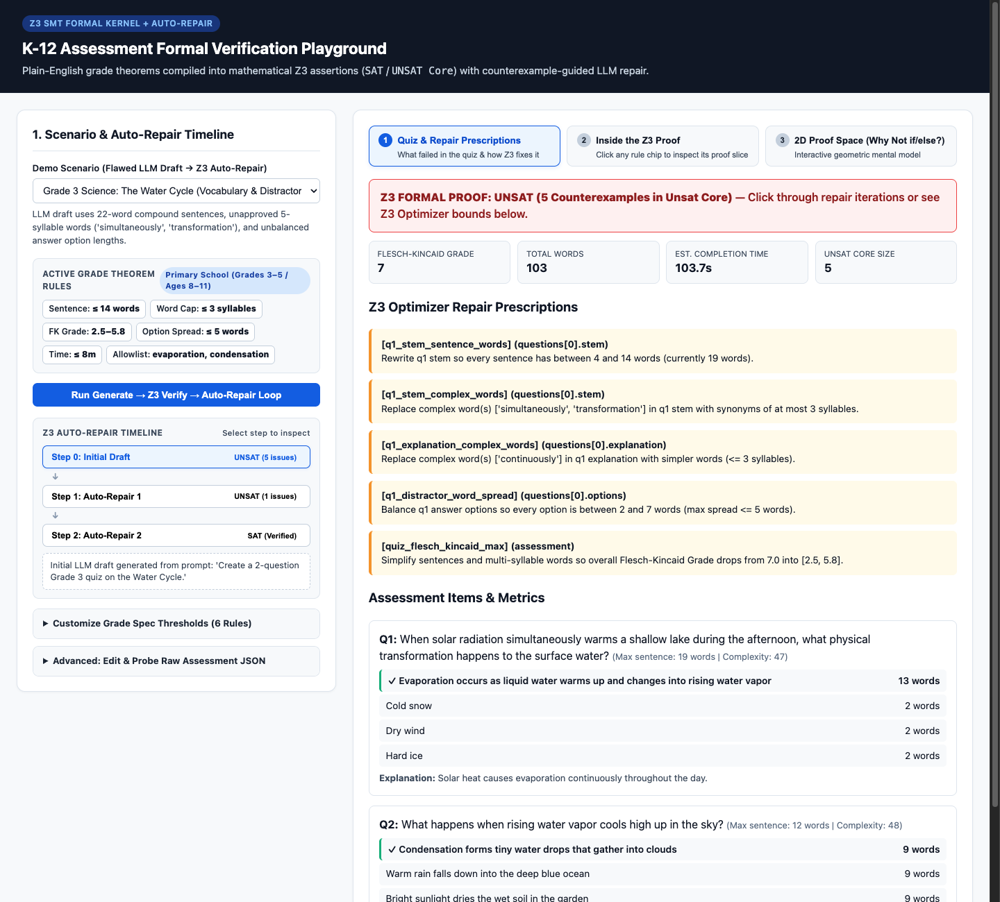
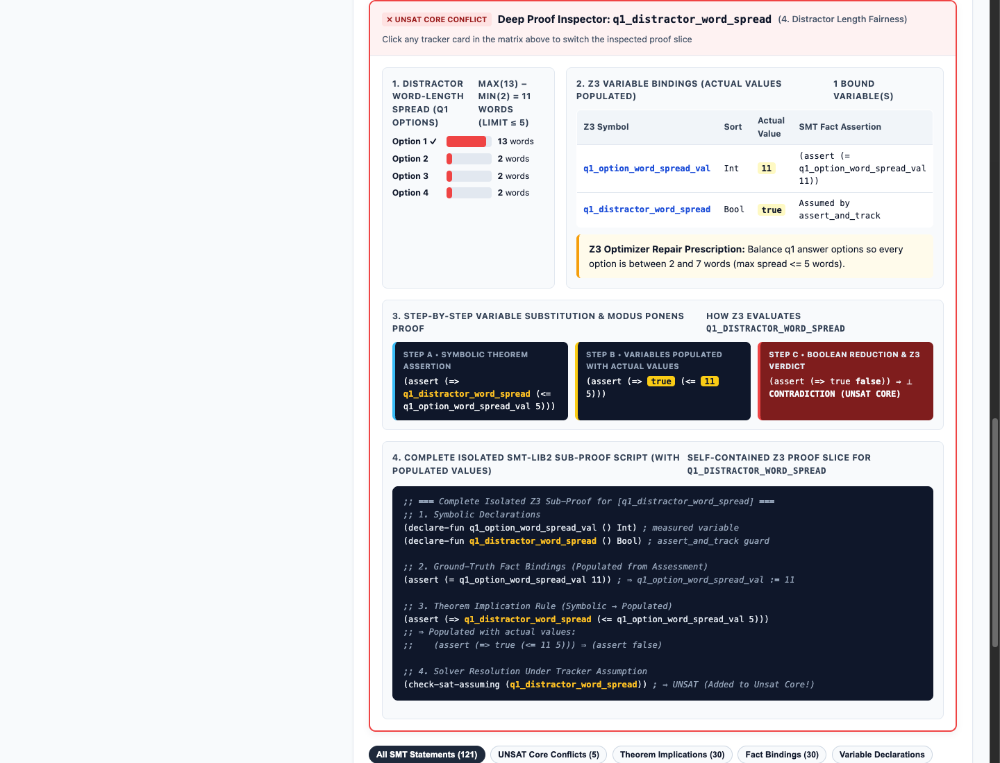
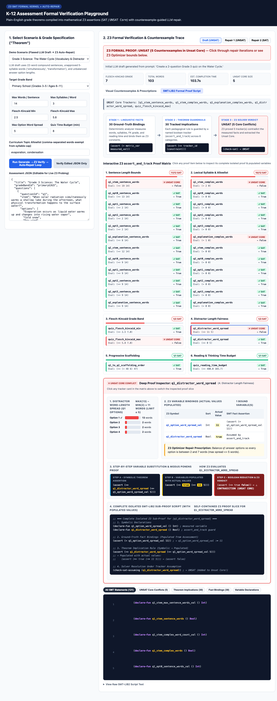
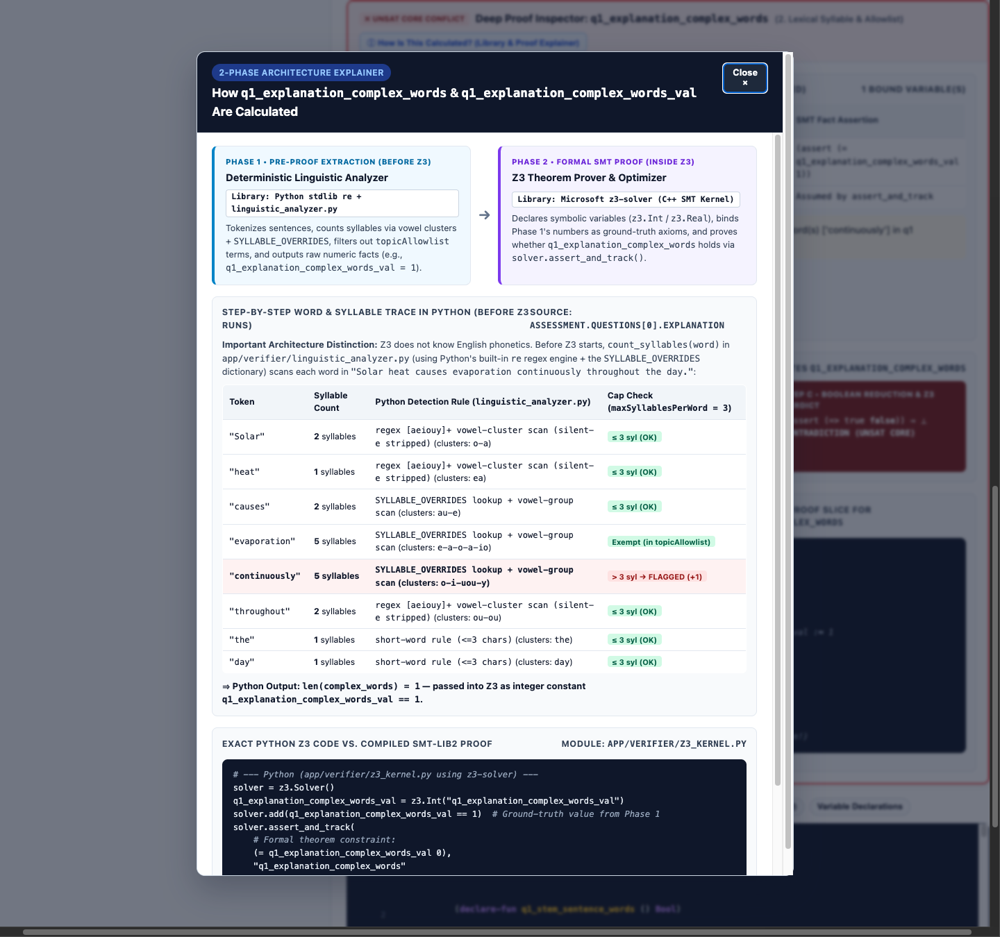
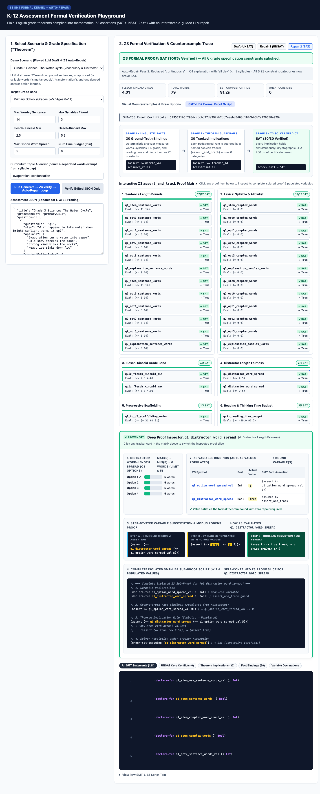
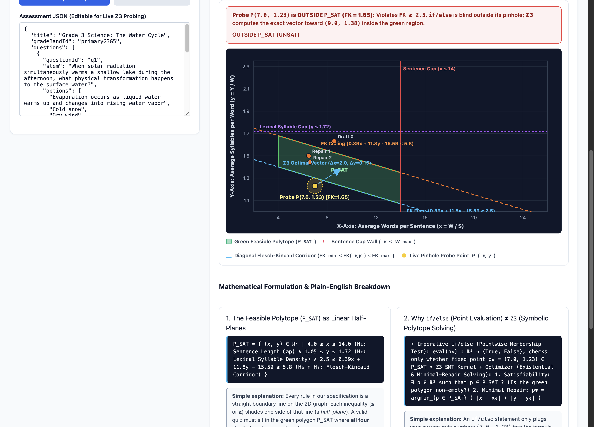

# K-12 Educational Content Formal Verification Playground

> **Built with [Google Antigravity](https://antigravity.google) and Gemini 4 Argon.**

Inspired by [Anthropic's Formal Verification Research](https://www.anthropic.com/research/formal-verification), this project brings **Formal Verification** to Primary and Secondary School educational content (assessments and quizzes) without requiring educators to have a mathematics background.

Instead of relying on probabilistic "LLM-as-a-judge" checks, this system pairs an LLM generator with a **deterministic linguistic analyzer** and **Microsoft's Z3 SMT Theorem Prover (`z3-solver`)**:

1. **Plain-English Grade Specifications ("Theorems"):** Configurable grade-band profiles (`Primary Grades 1–2`, `Primary Grades 3–5`, `Lower Secondary Grades 6–8`, `Upper Secondary Grades 9–12`) + curriculum `topicAllowlist` terms.
2. **Formal SMT-LIB2 Verification (`z3.Solver` + `assert_and_track`):** Verifies 6 formal constraint categories simultaneously:
   - Sentence length upper bounds (`maxWordsPerSentence`)
   - Lexical syllable complexity with curriculum allowlists (`maxSyllablesPerWord` + `topicAllowlist`)
   - Whole-assessment Flesch-Kincaid Grade Level band (`[fleschKincaidMin, fleschKincaidMax]`)
   - Multiple-choice distractor length fairness (`maxOptionWordSpread`)
   - Progressive question complexity scaffolding (`maxBackwardComplexityDrop`)
   - Student reading & thinking time budget (`quizDurationMinutes` at grade `readingSpeedWpm`)
3. **Counterexample-Guided Auto-Repair (`UNSAT Core` + `z3.Optimize`):** When an assessment fails verification (`UNSAT`), Z3 extracts the minimal unsatisfiable core and solves for the exact target word/syllable bounds needed to guide automatic LLM self-repair until `SAT` (100% verified) is achieved.

---

## Interactive Playground & Proof Visualizations

### 1. Counterexample Detection & Z3 Optimizer Prescriptions (`Draft: UNSAT`)

When an initial LLM draft is evaluated against the **Primary School (Grades 3–5)** specification, Z3 flags all violated theorem constraints simultaneously and uses `z3.Optimize` (Manhattan-distance minimization) to prescribe exact numerical repair targets:



---

### 2. Deep SMT-LIB2 Proof Inspector: Understanding an `UNSAT` Proof (`q1_distractor_word_spread`)

Clicking the **SMT-LIB2 Formal Proof Script** tab and selecting any proof item in the **`assert_and_track` Proof Matrix** (such as `q1_distractor_word_spread`) opens the **Deep Proof Inspector**, which breaks down how Z3 proves a counterexample from the raw assessment text to the final SMT contradiction:



#### How the `q1_distractor_word_spread` `UNSAT` Proof Works Step-by-Step:

1. **Source Text & Linguistic Measurement (`max(13) - min(2) = 11 words`):**
   - In the flawed Grade 3 draft, the correct answer (Option 1) has **13 words** (`"Evaporation occurs as liquid water warms up and changes into rising water vapor"`), while the three distractors (Options 2–4) have only **2 words** each (`"Cold snow"`, `"Dry wind"`, `"Hard ice"`).
   - This is a classic multiple-choice "length giveaway" flaw: students can guess Option 1 purely by its length. The deterministic analyzer measures `spread = 13 - 2 = 11` words.
2. **Z3 Ground-Truth Variable Binding:**
   - The measured spread is bound to an SMT integer constant:
     ```lisp
     (declare-fun q1_option_word_spread_val () Int)
     (assert (= q1_option_word_spread_val 11))
     ```
   - The Grade 3–5 theorem requires `maxOptionWordSpread <= 5`, guarded by the boolean tracker `q1_distractor_word_spread`:
     ```lisp
     (declare-fun q1_distractor_word_spread () Bool)
     (assert (=> q1_distractor_word_spread (<= q1_option_word_spread_val 5)))
     ```
3. **Variable Substitution & Modus Ponens Contradiction (`⊥ UNSAT CORE`):**
   - **Step A (Symbolic Assertion):** `(assert (=> q1_distractor_word_spread (<= q1_option_word_spread_val 5)))`
   - **Step B (Variables Populated with Actual Values):** Substituting `q1_distractor_word_spread := true` and `q1_option_word_spread_val := 11` yields:
     ```lisp
     (assert (=> true (<= 11 5)))
     ```
   - **Step C (Boolean Reduction):** Because `(<= 11 5)` evaluates to `false`, the implication reduces to `(assert (=> true false))` $\equiv$ `(assert false)` $\Rightarrow$ **`⊥ CONTRADICTION`**, placing `q1_distractor_word_spread` into Z3's **`UNSAT Core`**.
4. **Z3 Optimizer Repair Prescription (`z3.Optimize`):**
   - Rather than merely rejecting the question, `z3.Optimize` solves for target option lengths $L'_1, \dots, L'_4$ minimizing $\sum |L'_j - L_j|$ subject to $\max(L') - \min(L') \le 5$, prescribing:
     > *"Balance q1 answer options so every option is between 2 and 7 words (max spread <= 5 words)."*

Full-page view of the **SMT-LIB2 Formal Proof Script** tab during `UNSAT` analysis:



---

### 3. 2-Phase Architecture Explainer Popup: Pre-Proof Linguistic Calculation vs. Z3 Proof (`q1_explanation_complex_words`)

Clicking **`ⓘ How Is This Calculated? (Library & Proof Explainer)`** (or any Z3 variable symbol in the Variable Binding Table) opens a modal breaking down what happens **before** the Z3 proof versus **inside** the Z3 SMT solver:



- **Phase 1 — Pre-Proof Deterministic Extraction (`app/verifier/linguistic_analyzer.py`):**
  - **Library:** Python Standard Library (`re` regex tokenizer + deterministic vowel-cluster scanner `[aeiouy]+` + [`SYLLABLE_OVERRIDES`](file:///Users/mashhoodr/dev/playground/educationformalverification/app/verifier/linguistic_analyzer.py)).
  - Scans `"Solar heat causes evaporation continuously throughout the day."` word-by-word **before** Z3 starts:
    - `"evaporation"` (5 syllables) $\rightarrow$ **Exempt** because it is listed in `topicAllowlist`.
    - `"continuously"` (5 syllables, clusters `o-i-uou-y`) $\rightarrow$ **Flagged (`+1`)** because `5 > 3` (`maxSyllablesPerWord`) and it is not allowlisted.
  - Outputs the integer `1` (`len(explanation_complex_words)`).
- **Phase 2 — Formal SMT Proof (`app/verifier/z3_kernel.py`):**
  - **Library:** Microsoft Research `z3-solver` (C++ SMT kernel bindings).
  - Binds Phase 1's output as an SMT integer fact `(assert (= q1_explanation_complex_words_val 1))` and checks the tracked theorem implication `(assert (=> q1_explanation_complex_words (= q1_explanation_complex_words_val 0)))`, proving `1 = 0` is `false` (`UNSAT Core`).

---

### 4. Verified Assessment & Cryptographic Proof Certificate (`Repair 2: SAT`)

After counterexample-guided auto-repair balances all four options to **5 words each** (`spread = 5 - 5 = 0 <= 5`), simplifies sentences to `<= 14 words`, and replaces unapproved `>3`-syllable words, `(check-sat)` resolves to **`SAT` (`30/30 Verified`)** and issues a SHA-256 proof certificate:



---

### 5. 2D Feasible Proof Space: Why Formal Verification (`Z3 SMT`) Is More Rigorous Than `if/else`

A common question when first inspecting SMT assertions is: *"Doesn't a proof just act like an `if/else` statement with `assert`s?"*

The **2D Feasible Proof Space (`Why Not if/else?`)** tab in the Playground (and our deep-dive guide in [`docs/formal-verification-vs-if-else.md`](docs/formal-verification-vs-if-else.md)) illustrates the geometric and mathematical difference using **Visual Mental Model 1 (The Pinhole Flashlight vs. The 2D Feasible Polytope)**:



#### Mathematical Formulation & Simple Plain-English Explanations

1. **The Feasible Polytope ($\mathcal{P}_{\text{SAT}}$) as an Intersection of Linear Half-Planes:**

$$\mathcal{P}_{\text{SAT}} = \left\{\, (x, y) \in \mathbb{R}^2 \;\middle|\; 4.0 \le x \le W_{\max} \;\land\; 1.05 \le y \le Y_{\max} \;\land\; \text{FK}_{\min} \le 0.39x + 11.8y - 15.59 \le \text{FK}_{\max} \,\right\}$$

   - **Simple explanation:** On our 2D graph where the X-axis is **Words per Sentence ($x = W/S$)** and the Y-axis is **Syllables per Word ($y = Y/W$)**, every rule in the specification draws a straight boundary wall and shades one side of it (a *half-plane*). Because Flesch-Kincaid ($\text{FK}(x,y) = 0.39x + 11.8y - 15.59$)couples $x$ and $y$ linearly, the Flesch-Kincaid floor and ceiling form **slanted diagonal walls**. A valid quiz must sit inside the **shaded green polygon $\mathcal{P}_{\text{SAT}}$** where all four half-planes overlap simultaneously.

2. **Pointwise Membership (`if/else`) vs. Symbolic Polytope Solving (`Z3 SMT` + `Optimize`):**

$$\text{Imperative if/else:} \quad \text{eval}(p_0) : \mathbb{R}^2 \to \{\text{True}, \text{False}\}, \quad \text{checks only whether fixed point } p_0 = (x_0, y_0) \in \mathcal{P}_{\text{SAT}}$$

$$\text{Z3 Satisfiability & Optimal Repair:} \quad \exists\, p \in \mathcal{P}_{\text{SAT}} \quad \text{and} \quad p^* = \arg\min_{p \in \mathcal{P}_{\text{SAT}}} \left( |x - x_0| + |y - y_0| \right)$$

   - **Simple explanation:**
     - **Why `if/else` falls into the Whack-a-Mole Trap:** An `if/else` check is like a **pinhole flashlight**—it only sees the single coordinate $p_0 = (x_0, y_0)$ of your current draft. If a sentence is too long ($x = 19 > 14$) and a naive `if/else` fix splits it in half to $x = 7.0$ while $y = 1.23$, the Flesch-Kincaid grade drops to $1.65$—crashing right through the blue $\text{FK}_{\min} = 2.5$ floor!
     - **Why Z3 succeeds:** Z3 solves all boundary walls simultaneously as algebraic equations. It knows the exact coordinates of the green polygon $\mathcal{P}_{\text{SAT}}$, proves immediately if a teacher's specification is self-contradictory ($\mathcal{P}_{\text{SAT}} = \emptyset$), and computes the shortest repair vector $\Delta = (\Delta x, \Delta y)$ to land inside the green region on the next step.

---

## Quick Start

```bash
python3 -m venv .venv
.venv/bin/pip install -r requirements.txt
.venv/bin/pytest -v
.venv/bin/uvicorn app.main:app --reload --port 8000
```

Then open `http://localhost:8000` in your browser.

## Attribution

Designed, planned, and implemented autonomously using **Google Antigravity** powered by **Gemini 4 Argon**.
