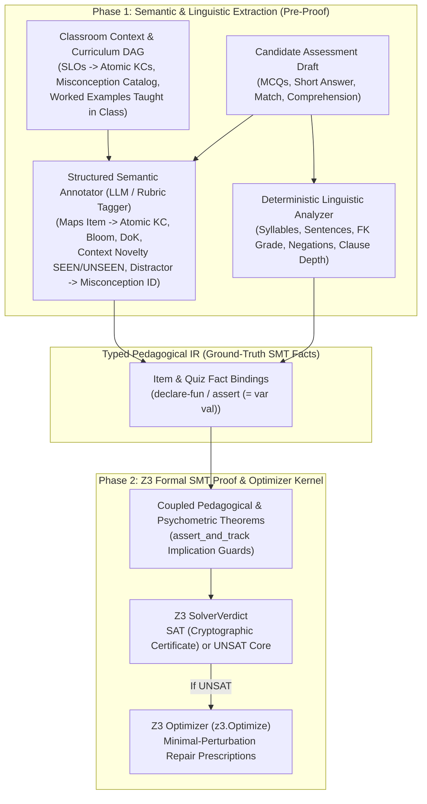

# Neuro-Symbolic Pedagogical Intermediate Representation (IR) Architecture

A central question in applying formal methods to education is:

> **"What is mathematically provable by an SMT solver (`Z3`), what requires semantic/pedagogical judgment (`LLM / Domain Graph`), and how do the two layers connect without brittle hacks?"**

---

## 1. The Anti-Pattern: Direct Raw-Text-to-Z3 Heuristics

If we attempt to prove high-level pedagogical properties (like Bloom's Taxonomy or misconception coverage) directly from raw strings using regexes, the proofs become brittle and gameable:
- **False Positive Verb Matching:** Checking if a question stem contains the word `"analyze"` or `"compare"` does not prove the question requires analysis. *"Analyze the four words below and circle the one that starts with B"* is a $\text{DoK } 1$ recall item disguised with a $\text{Bloom } 4$ verb.
- **Unverified Semantic Claims:** Conversely, asking an LLM *"Is this quiz aligned to Grade 3 standards and well-balanced?"* yields a probabilistic, unverified opinion that frequently hallucinates arithmetic counts, time budgets, and distribution ratios.

---

## 2. The Solution: Typed Pedagogical IR + Z3 Blueprint Verification

We separate the system into **two strictly defined phases** connected by a **Typed Pedagogical Intermediate Representation (IR)**:

---

## 3. Division of Responsibility: What Lives Where?

| Verification Layer | Input | Output | Responsibility |
| :--- | :--- | :--- | :--- |
| **1A. Deterministic Linguistic Analyzer (`Python`)** | Raw assessment text + `topicAllowlist` | Exact integer/real counts (`words`, `sentences`, `syllables`, `fleschKincaid`, `negationCount`, `optionWordSpread`) | **100% deterministic syntactic measurement.** Zero LLM involvement. |
| **1B. Semantic Pedagogical Extractor (`Structured LLM / Knowledge Graph`)** | Assessment items + Curriculum KC Graph + Lesson Context (`SEEN` examples) | Structured item claims (`targetKcId`, `bloomLevel`, `dokLevel`, `contextNovelty`, `distractorMisconceptionIds`, `workingMemoryChunks`) | **Semantic classification against an explicit ontology.** Auditable per item. |
| **2A. Z3 Cross-Validation Axioms (`z3-solver`)** | Layer 1A measurements + Layer 1B semantic claims | Consistency proofs (`SAT` / `UNSAT Core`) | **Catches LLM tagging hallucinations!** E.g., if Layer 1B claims an item is `DoK 3 (Strategic Thinking)` but Layer 1B also tags it as `SEEN` in class (or Layer 1A measures a 4-word single-clause stem), Z3 rejects the claim via the **Transfer Validity & Structural Non-Degeneracy Axioms**. |
| **2B. Z3 Assembly & Psychometric Kernel (`z3-solver` + `z3.Optimize`)** | Full quiz IR + `GradeSpec` + `FormativeBlueprint` | Proof certificate (`SAT`) or exact repair prescriptions (`UNSAT Core`) | **Global combinatorial & linear arithmetic proof:** proves KC sufficiency ($P(\text{guess}) \le 0.10$), Bloom/DoK quotas, `SEEN`/`UNSEEN` ratios, distractor misconception uniqueness (`Distinct`), language-vs-cognitive load decoupling, and total time budget. |

---

## 4. Why Cross-Validating Semantic Claims in Z3 Is So Powerful

Even though an LLM proposes the semantic tags for an item (e.g., *"Question 2 tests `KC-3.2.A2` at `DoK 2` using example `boiling kettle`"*), **Z3 does not blindly trust the LLM's conclusion**. Instead, Z3 enforces **cross-constraint axioms** that link objective facts to pedagogical claims:

1. **The `SEEN` Context Collapse Axiom:**
   - The Lesson Plan records `workedExamplesSeen = {"boiling_kettle", "rain_puddle"}`.
   - If the LLM generates a question using `"boiling_kettle"` and claims `dokLevel = 2`, Z3 checks:
     $$\text{exampleId}(q) \in \text{workedExamplesSeen} \implies \text{effectiveDoK}(q) = 1$$
   - Because `effectiveDoK(q) = 1`, the quiz now fails the `minDok2Items` blueprint constraint (`UNSAT Core: [q2_transfer_novelty_violation]`)!
2. **The Diagnostic Distractor Bijection Axiom:**
   - For each wrong option $d_j$ in an MCQ, the extractor must map $d_j$ to a known misconception ID $m_j \in \mathcal{M}_{\text{KC}}$ (or `NONE` if it is a random/implausible filler).
   - Z3 enforces:
     $$\forall j,\, m_j \neq \text{NONE} \quad \land \quad \text{Distinct}(m_1, m_2, m_3)$$
   - If the LLM wrote two distractors that test the *same* misconception, or wrote a throwaway distractor (`NONE`), Z3 flags the exact option and prescribes which unrepresented misconception from $\mathcal{M}_{\text{KC}}$ to use instead.
