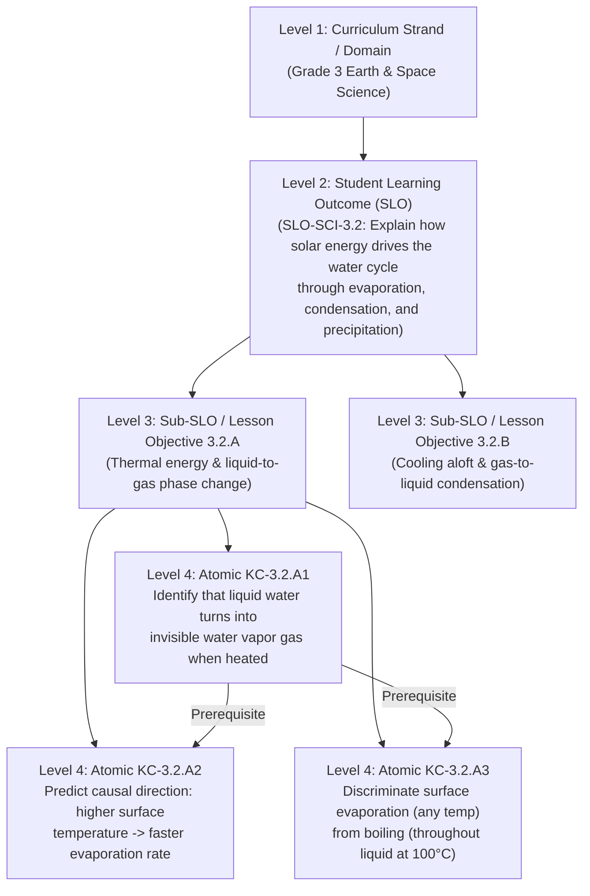

# Dimension 1: Student Learning Outcomes (SLOs), Atomic KCs & Item Sufficiency

## 1. The Core Question: "2–3 Questions Define Mastery of *What*?"

When educators say *"We need 2 to 3 questions per skill on a formative quiz to check for mastery,"* what is the exact unit of knowledge being measured?

- **Is it a Student Learning Outcome (SLO) / Curriculum Standard?** **No.** A curriculum SLO (e.g., *"CCSS.MATH.4.NF.B.3: Understand a fraction $a/b$ with $a > 1$ as a sum of fractions $1/b$, add and subtract mixed numbers, and solve word problems"*) is a **macro-container** that spans weeks of instruction and bundles 5 to 12 distinct mental operations. Testing a whole SLO with 2–3 questions yields zero diagnostic signal.
- **Is it a Topic inside the SLO?** **Still too coarse.** A topic like *"Adding Mixed Numbers"* still bundles common denominators, improper-fraction regrouping, and whole-number addition.
- **The True Unit of Mastery: The Atomic Knowledge Component (KC) / Micro-Skill.**
  In cognitive psychology (**Koedinger's KLI Framework**) and psychometrics (**Cognitive Diagnostic Models / Q-Matrix Theory**), 2–3 questions can only prove mastery of a single **Atomic Knowledge Component (KC)**—an indivisible mental rule, concept, or transformation where a student either knows the rule or holds a specific misconception.

---

## 2. The 4-Level Curriculum Decomposition Hierarchy

To verify alignment formally, every curriculum standard must be decomposed into a 4-level tree where the leaves form a **Prerequisite Directed Acyclic Graph (DAG)** of Atomic KCs:

### Formal Definition of an Atomic KC
A unit of knowledge $k$ is an **Atomic KC** if and only if:
1. **Single Cognitive Rule:** It represents one state transition, causal link, classification boundary, or procedural step.
2. **Enumerated Misconception Set ($\mathcal{M}_k$):** Every predictable student error on $k$ maps to a finite set of 2–5 specific misconceptions $\mathcal{M}_k = \{m_1, m_2, \dots, m_r\}$.
3. **Local Independence:** If a student masters $k$, their probability of answering any unconfounded item testing *only* $k$ is $1 - s_i$ (where $s_i$ is the slip rate).

---

## 3. Mathematical Formulation of Mastery & Item Sufficiency (The Q-Matrix & DINA Model)

In **Cognitive Diagnostic Modeling (CDM)** (specifically the **DINA — Deterministic Inputs, Noisy "And" Gate** model), a formative assessment of $I$ items testing $K$ Atomic KCs is defined by a binary **Q-Matrix** $Q \in \{0, 1\}^{I \times K}$, where $q_{i,k} = 1$ if item $i$ requires Atomic KC $k$.

For each item $i$, let:
- $g_i = P(\text{Pass}_i \mid \text{Unmastered}_k)$ be the **Guessing (False-Positive) Probability**.
- $s_i = P(\text{Fail}_i \mid \text{Mastered}_k)$ be the **Slip (Careless Error) Probability**.

### The False-Mastery Bound across $n_k$ Items
If a student has **not** mastered Atomic KC $k$, the probability that they pass **all** $n_k$ items testing KC $k$ by luck is:

$$P(\text{False Mastery of } k) = \prod_{i : q_{i,k}=1} g_i$$

To guarantee at least **$90\%$ diagnostic confidence** ($\alpha \le 0.10$) that passing means genuine mastery:

$$\prod_{i : q_{i,k}=1} g_i \le 0.10 \iff \sum_{i : q_{i,k}=1} \left(-\log_{10} g_i\right) \ge 1.0$$

> **Why that logarithmic transformation matters for Z3:** By taking $I_{\text{info}}(i) = -\log_{10}(g_i)$ as each item's **Diagnostic Information Weight**, the nonlinear probability product $\prod g_i \le 0.10$ becomes a **pure linear inequality** in Z3 (`Real` arithmetic)!

---

## 4. How Different Question Types Change Sufficiency Math

Because different item formats have wildly different guessing probabilities $g_i$ and classroom time costs $t_i$, we can formally mix and match item formats in Z3:

| Item Format | Guessing Prob ($g_i$) | Diagnostic Info Weight $w_i = -\log_{10}(g_i)$ | Items Needed for $\sum w_i \ge 1.0$ ($\alpha \le 0.10$) | Best Pedagogical Role in a Formative Quiz |
| :--- | :---: | :---: | :---: | :--- |
| **3-Option MCQ (Grades K–2)** | $0.333$ | $0.48$ | **3 items** ($3 \times 0.48 = 1.44 \ge 1.0$) | Fast foundational check + misconception trapping for early readers |
| **4-Option MCQ (Grades 3–12)** | $0.250$ | $0.60$ | **2–3 items** ($2 \times 0.60 = 1.20 \ge 1.0$) | Rapid diagnostic check where each distractor maps to a distinct misconception |
| **Match-the-Column ($4 \times 5$ matrix)** | $\approx 0.04$ | $1.40$ | **1 matrix** (covers $3\text{--}4$ sibling boundary KCs at once) | Testing boundary discrimination across related concepts (e.g., *Evaporation vs. Boiling vs. Condensation*) |
| **Short Answer / Fill-in-Blank** | $\approx 0.05$ | $1.30$ | **1–2 items** ($1$ `SEEN` + $1$ `UNSEEN`) | Eliminates recognition cueing; proves active retrieval & generation |
| **Comprehension Set (Passage + 3 Items)** | $0.25$ per sub-item | $0.60$ per sub-item | **1 shared stimulus + 2–3 linked items** | Amortizes reading time across $\text{DoK } 1$ retrieval $\to \text{DoK } 2$ inference $\to \text{DoK } 3$ evaluation |
| **Long Answer / Constructed Explanation** | $\approx 0.01$ | $2.00$ | **1 item** (plus 1 fast $\text{DoK } 1$ prerequisite MCQ) | Proves multi-step causal reasoning across $2$ linked KCs simultaneously |

---

## 5. The Ideal 3-Item "Diagnostic Probe Triplet" for a Single Atomic KC

When a formative quiz uses MCQs or mixed formats to test a single Atomic KC $k$, why is **2–3 items** the gold standard? Because each item in the triplet probes a distinct layer of mastery:

1. **Probe 1 — The Foundational Anchor (`DoK 1`, `SEEN` Context):**
   - Verifies that the student understood the basic rule using a familiar representation from class.
2. **Probe 2 — The Near-Transfer Check (`DoK 2`, `UNSEEN` Context):**
   - Changes the surface scenario (`UNSEEN`) while keeping the underlying KC identical.
   - *Diagnostic comparison:* If a student passes Probe 1 (`SEEN`) but fails Probe 2 (`UNSEEN`), the teacher immediately knows the student **memorized the classroom example without abstracting the concept**.
3. **Probe 3 — The Boundary / Misconception Trap (`DoK 2–3`, `UNSEEN` Context or Short Answer):**
   - Specifically pits the target KC against its #1 competing misconception (e.g., testing whether evaporation still happens on a cool, windy day vs. only when boiling).

---

## 6. What Z3 Proves for Dimension 1 (`SMT-LIB2` Formulation)

Given a set of target lesson KCs $\mathcal{K}_{\text{target}}$ and classroom time budget $T_{\max}$:

1. **Diagnostic Information Sufficiency per Target KC:**
   $$\forall k \in \mathcal{K}_{\text{target}}, \quad \sum_{i : q_{i,k}=1} w_{\text{info}}(i) \ge 1.20 \quad (\text{guarantees } P(\text{False Mastery}) \le 0.0625)$$
2. **Multi-Point Probing (Minimum 2 Distinct Items for MCQ-Only KCs):**
   $$\forall k \in \mathcal{K}_{\text{target}}, \quad \text{count}(i : q_{i,k}=1) \ge 2 \quad \lor \quad \exists i : \left(q_{i,k}=1 \land \text{format}(i) \in \{\text{ShortAnswer}, \text{LongAnswer}, \text{Match}\}\right)$$
3. **Single-KC Purity for Diagnostic Items (No Confounded Multi-KC Stems on `DoK 1–2`):**
   - If an MCQ requires **two** unverified KCs at once ($q_{i,k_1}=1 \land q_{i,k_2}=1$) and the student fails it, you cannot tell whether $k_1$ or $k_2$ caused the failure (the **Credit/Blame Assignment Problem**).
   - Z3 enforces that every $\text{DoK } 1\text{--}2$ diagnostic item maps to **exactly 1 primary KC**, and any $\text{DoK } 3$ synthesis item that combines $k_1 + k_2$ is preceded by standalone checks for $k_1$ and $k_2$!
4. **Feasibility Knapsack Check (Scope vs. Time Budget):**
   - If a teacher selects $6$ Atomic KCs for a $5$-minute exit ticket, Z3 proves `UNSAT` immediately because $6 \text{ KCs} \times 2 \text{ items} \times 45\text{s} = 9 \text{ minutes} > 5 \text{ minutes}$, and `z3.Optimize` recommends narrowing the exit ticket to $\le 3$ Atomic KCs.

---

## 7. Cross-Grade SLO Overlap & Vertical Boundary Envelopes ($\text{SLO}_{G-1} \to \text{SLO}_G \to \text{SLO}_{G+1}$)

In real K–12 curricula (the **Spiral Curriculum**), SLOs across grades overlap in topic (e.g., *Fractions*, *The Water Cycle*, *Reading Main Idea*), but shift in **parameter domain**, **causal mechanism depth**, and **stimulus representation**.

If you decompose $\text{SLO}_G$ in isolation, an LLM does not know where **Grade $G-1$ ends** or where **Grade $G+1$ begins**:
- It may generate under-leveled items that only test the Grade $G-1$ subset (**Below-Grade Drift**).
- Or it may leak Grade $G+1$ mechanisms (e.g., molecular kinetic energy in a Grade 3 Water Cycle quiz) into stems, explanations, or distractors (**Upper-Grade Boundary Leak**).

### The Vertical Triad Boundary Model
To establish mathematically clean boundaries, we decompose a **Vertical Triad of Official Standards** $\langle \text{SLO}_{G-1}, \text{SLO}_G, \text{SLO}_{G+1} \rangle$ simultaneously into three disjoint zones for Grade $G$:

$$\mathcal{E}(G) = \left\langle \underbrace{\mathcal{K}_{\text{prereq}}(G-1)}_{\text{Prior-Grade Foundation}}, \quad \underbrace{\mathcal{K}_{\text{delta}}(G) = \text{SLO}_G \setminus \text{SLO}_{G-1}}_{\text{Target Grade } G \text{ Mastery Delta}}, \quad \underbrace{\mathcal{F}_{\text{ceiling}}(G+1) = \text{SLO}_{G+1} \setminus \text{SLO}_G}_{\text{Forbidden Future-Grade Ceiling}} \right\rangle$$

1. **Upper-Grade Ceiling Proof (`q_upper_grade_boundary_leak`):**
   - Everything newly introduced in $\text{SLO}_{G+1}$ automatically becomes the **Forbidden Ceiling $\mathcal{F}_{\text{ceiling}}(G+1)$** for Grade $G$:
     $$\forall q_i \in \text{Quiz}_G, \quad \text{requiredKcs}(q_i) \cap \mathcal{F}_{\text{ceiling}}(G+1) = \emptyset$$
2. **Grade-Level Delta Quota Proof (`quiz_grade_delta_focus`):**
   - At least $70\%$ of the assessment's diagnostic information weight must target $\mathcal{K}_{\text{delta}}(G)$ (what is *newly added* in Grade $G$), while at most $30\%$ may probe $\mathcal{K}_{\text{prereq}}(G-1)$ as a diagnostic bridge to check if a struggling student is missing a prior-grade prerequisite.
3. **Stimulus & Parameter Envelope Disambiguation:**
   - When two grades share the same skill verb (e.g., *"Find equivalent fractions"* in Grade 3 vs. Grade 4, or *"Identify the main idea"* in Grade 3 vs. Grade 5), each grade's KC carries explicit domain constraints (e.g., Grade 3 denominators $d \in \{2,3,4,6,8\}$ vs. Grade 4 $d \in \{2,3,4,5,6,8,10,12,100\}$).

---

## 8. Stage 0 Verification: How Do We Prove Our Generated KCs Are Correct First? ("The Root of Trust")

Before we can use Z3 to verify a quiz against Atomic KCs (Stage 1), **how do we verify that the Atomic KCs decomposed from the SLOs are valid in the first place?**

Our external **Root of Trust (Axioms)** is the official curriculum standard text across adjacent grades $\langle \text{SLO}_{G-1}, \text{SLO}_G, \text{SLO}_{G+1} \rangle$ parsed into its constituent grammatical verb-object clauses $C_{\text{SLO}}$.

**Stage 0 Verification** uses Z3 to prove **5 formal structural & boundary properties of the generated KC Graph itself** before locking the KCs for assessment generation:

| Stage 0 Z3 Proof Tracker | Mathematical / SMT Invariant | What LLM Decomposition Flaw It Catches |
| :--- | :--- | :--- |
| **0.1 Prerequisite DAG Acyclicity (`kc_dag_acyclic`)** | $\forall (u \to v) \in E_{\text{prereq}}, \; \text{rank}(u) < \text{rank}(v)$ | Catches circular prerequisite loops ($\text{KC}_A \to \text{KC}_B \to \text{KC}_A$). |
| **0.2 Vertical Grade Monotonicity (`kc_vertical_monotonicity`)** | $\forall (u \to v) \in E_{\text{prereq}}, \; \text{grade}(u) \le \text{grade}(v)$ | Prevents a Grade 3 KC from requiring a Grade 4 or Grade 5 KC as a prerequisite. |
| **0.3 Non-Empty Grade Delta & Disjoint Ceiling (`kc_grade_delta_disjoint`)** | $\mathcal{K}_{\text{delta}}(G) \neq \emptyset \;\land\; \mathcal{K}_{\text{delta}}(G) \cap \mathcal{K}_{\text{delta}}(G+1) = \emptyset$ | Catches duplicate/unchanged KCs across grades or fuzzy overlap between Grade $G$ targets and Grade $G+1$ ceilings. |
| **0.4 Structural Atomicity & Misconception Completeness (`kc_atomicity_valid`)** | $\forall k, \; \text{verbCount}(k) = 1 \;\land\; |\mathcal{M}_k| \ge 2$ | Rejects composite "blob" KCs (multiple verbs) or degenerate KCs that lack at least 2 distinct student misconceptions. |
| **0.5 Complete SLO Clause Coverage (`slo_clause_coverage`)** | $\forall c_j \in C_{\text{SLO}}, \; \sum_{k} \text{covers}(k, c_j) \ge 1$ | Catches silent omission when an LLM decomposes 2 clauses of an SLO and forgets the 3rd clause. |

