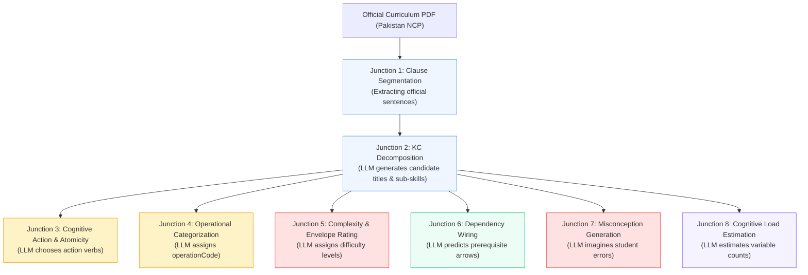

# Dimension 8: Generative Junctions, Anti-"Proof Theater" Rigor & Missing Proofs

> **Context:** When decomposing official curriculum standards (such as the **National Curriculum of Pakistan - NCP 2022–23**) into **Atomic Knowledge Components (KCs)**, an automated system performs multiple steps of generative content creation. 
> 
> This document maps **every point in the pipeline where content is generated**, identifies the **vulnerabilities and "proof theater" shortcuts** an AI might take, and details the **formal proofs and empirical groundings required** to ensure genuine pedagogical rigor.

---

## 1. The Core Danger: "Proof Theater" vs. Mathematical Rigor

As codified in [`AGENTS.md`](../../AGENTS.md):
> [!CAUTION]
> **A proof that merely verifies a self-fulfilling tautology is worse than useless—it is dangerous.**
> If an agent adds an SMT assertion just to produce a green `SAT` check without testing a genuine mathematical invariant or pedagogical ground truth, it violates the core mission of this project.

### Examples of "Proof Theater" in Education:
1. **The Tautological Check:** Asking an LLM to generate an integer label (e.g. `mechanismComplexity: 3`), and then having Z3 assert `mechanismComplexity == 3`. This proves nothing about whether the content is actually at complexity level 3; it only proves that the integer 3 equals the integer 3!
2. **The Renumbering Cheat:** When an LLM encounters a cross-grade boundary collision (e.g. Grade 3 addition collides with Grade 2 addition), "fixing" it by changing the integer label from 2 to 3 without modifying the actual linguistic or cognitive difficulty.
3. **The Label-Mismatch Illusion:** Asserting that a candidate Knowledge Component satisfies an official standard simply because the LLM pasted the string `M-03-A-21` into a JSON array, without verifying semantic alignment.
4. **The Hallucinated Bug Soundness Illusion:** Verifying that a candidate KC lists $\ge 3$ distinct strings for misconceptions, while all 3 strings describe impossible nonsense errors that real human children never make.

---

## 2. The 8 Generative Junctions in the KC Creation Pipeline

Every point where generative AI or heuristic extraction touches curriculum content introduces a specific vulnerability that demands formal proof:



---

### Junction 1: Official Curriculum PDF $\to$ Clause Segmentation
* **What is Generated:** The raw curriculum text is segmented into distinct, numbered clauses ($c_1, c_2, \dots, c_m$).
* **Vulnerability:** 
  - The parser silently drops a hard requirement (e.g. omitting *"and mixed numbers"*).
  - The parser splits a sentence such that qualifying conditions are lost (e.g. detaching *"within one whole"* from *"Add and subtract"*).
* **The "Proof Theater" Shortcut:** Asserting that 100% of the *parsed* clauses are covered, while ignoring unparsed sentences dropped from the original PDF.
* **Proof / Grounding Required:**
  - **Deterministic Bi-Directional Verb & Entity Coverage Audit:** Every action verb and domain entity in the raw NCP PDF text must map to at least one segmented clause:
    $$\mathcal{V}_{\text{raw}} \;\subseteq\; \bigcup_{i=1}^m \mathcal{V}(c_i)$$

---

### Junction 2: SLO Clause $\to$ Candidate KC Decomposition (Titles & Behavioral Scope)
* **What is Generated:** The LLM synthesizes the names, operational descriptions, and scope of candidate sub-skills.
* **Vulnerability:** 
  - **The Label Lie:** The LLM claims a KC covers clause `M-03-A-21` (Equivalent Fractions), but the generated title actually teaches decimal place value or general multiplication.
  - **Semantic Drift:** Shifting the cognitive level or domain without reflecting official intent.
* **The "Proof Theater" Shortcut:** Accepting the LLM's `coveredClauseIds` string array without validating content.
* **Proof / Grounding Required:**
  - **Deterministic Lexical Anchor & Semantic Projection Proof:** Computing token overlap, domain noun alignment, and embedding projection bounds between the official clause and the KC title:
    $$\text{Overlap}\Big(\text{Nouns}(c_{\text{official}}), \; \text{Nouns}(KC_{\text{title}})\Big) \;\ge\; \theta_{\text{anchor}}$$

---

### Junction 3: Cognitive Action & Verb Atomicity
* **What is Generated:** The LLM identifies the cognitive process (Bloom/Webb verb) needed for the step.
* **Vulnerability:** 
  - **The Conjoined Twin Blob:** Bundling two separate actions into one KC (*"Identify equivalent fractions AND reduce them to lowest terms"*). If a student fails this question, the teacher has no idea which of the two skills was missing.
* **The "Proof Theater" Shortcut:** Allowing an LLM to self-report `verbCount: 1` on a title containing multiple action verbs.
* **Proof / Grounding Required:**
  - **Deterministic Syntactic Dependency Tree Proof (Theorem 0.4):** A deterministic linguistic parser checks the sentence structure of the title. The count of root action predicates must strictly equal 1 ($\text{verbCount} = 1$). If $> 1$, Z3 refutes the graph with an `UNSAT Core`.

---

### Junction 4: Operational Categorization (`operationCode`)
* **What is Generated:** The LLM assigns an identifier like `identify_fractions` or `add_subtract_fractions`.
* **Vulnerability:** 
  - **Synonym Camouflage:** In Grade 2 the LLM calls it `add_fractions`, but in Grade 3 it calls it `sum_of_fractions`. Because the string names are different, a naive check thinks they are disjoint, hiding an illegal cross-grade duplicate!
* **The "Proof Theater" Shortcut:** Checking string inequality (`opCode1 != opCode2`) on free-text strings.
* **Proof / Grounding Required:**
  - **Closed Canonical Ontology Proof:** The operation code must map into a finite, accredited subject ontology lattice $\mathcal{O}_{\text{Math}}$ where equivalence classes are formally closed, preventing synonymous duplicates.

---

### Junction 5: Mechanism Complexity Level (The "Renumbering Cheat")
* **What is Generated:** The LLM assigns an integer (e.g. `complexity: 2` vs `complexity: 4`) representing difficulty.
* **Vulnerability:** 
  - **The Renumbering Cheat:** If Z3 flags a boundary collision between Grade 2 and Grade 3 addition, an LLM might simply change the JSON label from `2` to `4` without simplifying or changing the actual English content.
* **The "Proof Theater" Shortcut:** Checking `complexity_g3 > complexity_g2` on LLM self-reported numbers.
* **Proof / Grounding Required:**
  - **Deterministic Parameter-Derived Complexity Proof:** The complexity rating must **never** be generated as a free-floating integer by an LLM. It must be computed deterministically from concrete mathematical parameters:
    - *Like denominators ($b_1 = b_2$)* $\implies$ Complexity 2.
    - *Related denominators ($b_2 = k \cdot b_1$)* $\implies$ Complexity 4.
    - *Unrelated denominators ($\gcd(b_1, b_2) = 1$)* $\implies$ Complexity 6.
  - Z3 proves $\text{Complexity}(G_3) > \text{Complexity}(G_2)$ over **derived parameters**, not self-reported integers.

---

### Junction 6: Prerequisite Dependency Graph Wiring ($KC_u \to KC_v$)
* **What is Generated:** The LLM predicts which KCs are prerequisites for other KCs.
* **Vulnerability:** 
  - Circular dependency deadlocks ($A \to B \to A$).
  - Backward grade leaps (Grade 4 concept required to learn Grade 2).
  - Floating islands (Grade 4 having zero connections to Grade 3).
* **The "Proof Theater" Shortcut:** Checking acyclicity using a simple visited-set DFS without generating a global topological certificate.
* **Proof / Grounding Required:**
  - **Topological Rank Integer Proof (Theorem 0.1):** Z3 must solve an existential integer programming problem: finding integer ranks $\text{rank}(u) < \text{rank}(v)$ for every prerequisite edge.
  - **Vertical Grade Monotonicity & Bridge Proof (Theorem 0.2):** Proving $\text{grade}(u) \le \text{grade}(v)$ and $\ge 1$ cross-grade bridge edge.

---

### Junction 7: Student Misconceptions & Error Models
* **What is Generated:** The LLM generates the list of 3 diagnostic student errors for each KC.
* **Vulnerability:** 
  - Hallucinating arbitrary synthetic errors that real human children never make (e.g. *"Student cubes the denominator and subtracts 7"*).
  - Incomplete error models ($< 3$ errors), preventing 4-choice MCQ distractor generation.
  - Degenerate error rules that collapse to the same number as the correct answer.
* **The "Proof Theater" Shortcut:** Checking `len(misconceptions) >= 3` on free-text strings without checking cognitive validity.
* **Proof / Grounding Required:**
  - **Accredited Cognitive Catalog Proof (Theorem 0.5 Upgrade):** Every misconception must match a published procedural bug operator (Brown & Burton 1978, Siegler 2013) with a formal AST rewrite rule $\tau$ and documented classroom prevalence.
  - **Instance-Level Non-Degeneracy Proof:** Z3 proves $\text{Distinct}(\text{Key}, \tau_1(N), \tau_2(N), \tau_3(N))$.

---

### Junction 8: Working Memory & Cognitive Load Constraints
* **What is Generated:** The LLM estimates `observableVariablesCount`.
* **Vulnerability:** Requiring an 8-year-old child to simultaneously hold 5 parameters in working memory (2 numerators, 2 denominators, and a common multiple) without scaffolding, violating cognitive architecture.
* **The "Proof Theater" Shortcut:** Trusting an LLM's guess of cognitive load.
* **Proof / Grounding Required:**
  - **Sweller Cognitive Load Bound Proof (Theorem 0.4):** $\text{vars}(KC) \le \text{Capacity}(Grade)$, where capacity is bounded by cognitive developmental research (e.g. $\le 2$ variables for Grade 2, $\le 3$ for Grade 3).

---

## 3. The 5 Missing Proofs: Roadmap for Real Rigor

To eliminate all "Proof Theater" and achieve complete neuro-symbolic rigor, the following 5 missing proofs and groundings must be integrated:

| Missing Proof | Target Junction | Mathematical / Formal Technique | Primary Literature Reference |
| :--- | :--- | :--- | :--- |
| **1. Accredited Bug Catalog & AST Rewrite Operator Proof** | Junction 7 (Misconceptions) | Deterministic AST Mutation Operators $\tau: \text{AST} \to \text{AST}'$ verified against a finite, peer-reviewed bug catalog; Z3 proves distinctness on item numbers. | Brown & Burton (1978); VanLehn (1990); Siegler et al. (2013) |
| **2. Deterministic Parameter-Derived Complexity Proof** | Junction 5 (Mechanism Complexity) | Complexity $C(KC)$ computed algorithmically from AST step count and numeric domain bounds (e.g. denominator relations), eliminating LLM self-reported integers. | Sweller (1988) Cognitive Load Theory; Halford et al. (1998) Relational Complexity |
| **3. Bi-Directional Verb & Entity Coverage Audit** | Junction 1 (Curriculum Segmentation) | Bi-directional graph projection: Every action verb and domain entity in the raw official NCP standard must map to at least one segmented clause ($V_{\text{raw}} \subseteq \bigcup V_{\text{clauses}}$). | Natural Language Grammar Parsing (Dependency Parsing) |
| **4. Lexical Anchor & Semantic Projection Proof** | Junction 2 (Decomposition Alignment) | Token containment and entity overlap bounds proving candidate KC titles preserve the specific scope of the official SLO without semantic drift ("The Label Lie"). | Semantic Vector Projection & Set-Theoretic Word Containment |
| **5. Closed Canonical Ontology Membership Proof** | Junction 4 (Operation Taxonomy) | Finite lattice $\mathcal{O}_{\text{Math}}$ where operations belong to formal equivalence classes, preventing synonym camouflage across grade boundaries. | Description Logics & Formal Ontology Verification |

---

## 4. Grounding Deductive Proofs in Empirical Cognitive Science

Deductive first-order logic (Z3 SMT) and empirical cognitive science operate in tandem:

```
┌────────────────────────────────────────────────────────┐
│ Deductive Mathematical Realm (Z3 SMT Prover)           │
│ • Proves topological rank DAG acyclicity               │
│ • Proves grade monotonicity & bridge connectivity      │
│ • Proves distractor distinctness on item numbers       │
│ • Proves working memory upper bounds                   │
└───────────────────────────▲────────────────────────────┘
                            │ Instantiation & Verification
┌───────────────────────────┴────────────────────────────┐
│ Empirical Grounding Realm (Peer-Reviewed Cognitive Base)│
│ • Published Error Catalogs (Brown & Burton, Siegler)   │
│ • Classroom Diagnostic Response Models (DINA / CDM)    │
│ • Field Item Calibration (Distractor selection > 5%)   │
│ • Official National Curriculum Text (Pakistan NCP)     │
└────────────────────────────────────────────────────────┘
```

1. **The Axiomatic Base Pattern:** Just as cryptography assumes the hardness of prime factorization, our formal proofs assume an **Accredited Pedagogical Bug Catalog**.
2. **Post-Assessment Validation:** In the live classroom, Item Response Theory (IRT) and Cognitive Diagnostic Modeling (DINA) calibrate whether students actually choose the predicted distractors, completing the neuro-symbolic feedback loop.
