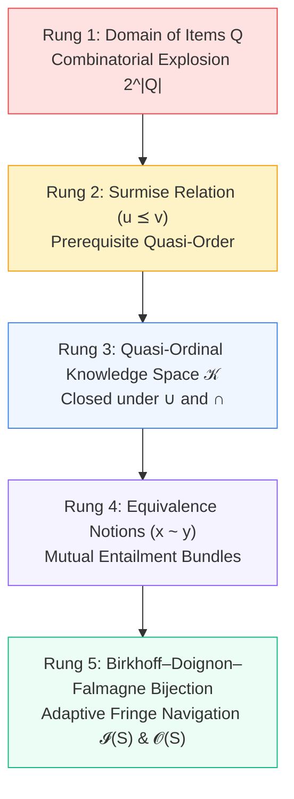

# Dimension 9: Knowledge Space Theory Foundations & Red-Team Mutation Evaluation

> **Context:** Before generating curriculum graphs (Stage 1) or formative assessments (Stage 2), an educational verification kernel requires two foundational mathematical pillars:
> 1. **Knowledge Space Theory (KST) & The Birkhoff–Doignon–Falmagne Representation Theorem:** The mathematical foundation for prerequisite ordering, valid knowledge states, and computerized adaptive testing (CAT).
> 2. **Red-Team Mutation Evaluation:** An empirical test harness proving that our formal verifier itself cannot be fooled by lazy AI shortcuts, closing the 5 major "Proof Theater" loopholes.

---

## 1. The 5 Conceptual Rungs of Knowledge Space Theory

Knowledge Space Theory, originally formulated by Jean-Paul Doignon and Jean-Claude Falmagne (1985, 1999), models the learning trajectories of students through a finite domain of cognitive skills or test items $Q$. Rather than assigning students a single real-valued scalar (like classical IQ or IRT $\theta$), KST represents each student's competence as a discrete **Knowledge State** $S \subseteq Q$.

We formalize KST across 5 progressive conceptual rungs compiled into Microsoft Z3 SMT assertions:



---

### Rung 1: Domain of Items & Combinatorial Explosion ($2^{|Q|}$)
* **Formal Definition:** Let $Q$ be a finite domain of items ($|Q| = n$). A candidate knowledge state is any subset $S \in \mathcal{P}(Q)$. The cardinality of the unconstrained state space is $|\mathcal{P}(Q)| = 2^n$.
* **Everyday Analogy:** In a 4-skill driving school test ($Q = \{\text{Steering, Clutch, Traffic, Parallel Parking}\}$), there are $2^4 = 16$ mathematically possible subsets, including absurd states like being able to navigate high-speed motorway traffic while completely unable to steer or operate a clutch.
* **Why Unconstrained Sets Fail:** Without pedagogical dependencies, testing an 8-skill fractions unit would require exploring $2^8 = 256$ states, and an entire elementary curriculum ($n \approx 100$) would yield $2^{100} \approx 1.26 \times 10^{30}$ states—more than the number of atoms in the human body.

---

### Rung 2: The Surmise Relation & Prerequisite Quasi-Order ($\preceq$)
* **Formal Definition:** A surmise relation $\preceq$ is a reflexive and transitive binary relation (a quasi-order) on $Q$:
  $$\forall x \in Q, \quad x \preceq x \quad (\text{Reflexivity})$$
  $$\forall u, v, w \in Q, \quad (u \preceq v \land v \preceq w) \implies u \preceq w \quad (\text{Transitivity})$$
* **Pedagogical Meaning:** $u \preceq v$ asserts that mastering item $v$ allows an evaluator to *surmise* that the student has also mastered prerequisite item $u$. Equivalently:
  $$\forall S \in \mathcal{K}, \quad v \in S \implies u \in S$$
* **Everyday Analogy:** If a driver successfully passes an advanced test in manual city traffic ($T$), the examiner safely surmises they already know how to steer ($S$) and balance the clutch ($C$).

---

### Rung 3: The Quasi-Ordinal Knowledge Space ($\mathcal{K}$ Closed Under $\cup$ and $\cap$)
* **Formal Definition:** A family $\mathcal{K} \subseteq \mathcal{P}(Q)$ is a **quasi-ordinal knowledge space** (or knowledge structure) if and only if:
  1. $\emptyset \in \mathcal{K}$ (the empty beginner state is valid).
  2. $Q \in \mathcal{K}$ (full curriculum mastery is valid).
  3. $\mathcal{K}$ is closed under union:
     $$\forall S_1, S_2 \in \mathcal{K} \implies (S_1 \cup S_2) \in \mathcal{K}$$
  4. $\mathcal{K}$ is closed under intersection:
     $$\forall S_1, S_2 \in \mathcal{K} \implies (S_1 \cap S_2) \in \mathcal{K}$$
* **Downwards-Closed Ideals:** Under quasi-order $\preceq$, every state $S \in \mathcal{K}$ is a downward-closed set (order ideal):
  $$\forall v \in S, \quad u \preceq v \implies u \in S$$
* **Z3 Formal SMT Proof:** Union and intersection closure are proven in Z3 via refutation-of-negation:
  ```lisp
  ; Refuting the existence of any two valid states whose union violates downward closure
  (assert (and
    (is_valid_state S1)
    (is_valid_state S2)
    (not (is_valid_state (union S1 S2)))
  ))
  ; Z3 returns UNSAT (No counterexample can exist in quasi-ordinal spaces)
  ```

---

### Rung 4: Equivalence Bundles & "Notions" ($x \sim y$)
* **Formal Definition:** In real curricula, two or more items may mutually require each other. We define the equivalence relation $\sim$ on $Q$:
  $$x \sim y \iff (x \preceq y \land y \preceq x)$$
  The equivalence classes $Q / \sim$ are termed **Notions**.
* **Pedagogical Property:** A student cannot master a proper fraction of a Notion:
  $$\forall S \in \mathcal{K}, \quad \text{Notion } N \subseteq S \quad \lor \quad N \cap S = \emptyset$$
* **Pakistan NCP Example:** In Grade 3 Mathematics, standard `M-03-A-21` (*"Identify equivalent fractions"*) and `M-03-A-22` (*"Simplify fractions to lowest term"*) form a Notion bundle. Both operations require the exact same rational scaling invariance ($a/b = ka/kb$); it is psychometrically impossible to truly master equivalence while unable to simplify fractions.

---

### Rung 5: The Birkhoff–Doignon–Falmagne Representation Theorem & Adaptive Fringes
* **The Fundamental Theorem (Birkhoff 1937, Doignon & Falmagne 1985):**
  > **Theorem:** There is a bijective duality between finite quasi-orders $(Q, \preceq)$ and finite distributive lattices of knowledge states $(\mathcal{K}, \subseteq, \cup, \cap)$. Every valid knowledge space closed under union and intersection is uniquely isomorphic to the lattice of downward-closed ideals of its surmise quasi-order.
* **Computerized Adaptive Navigation (The Fringes):** For any current student state $S \in \mathcal{K}$:
  1. **Inner Fringe $\mathcal{I}(S)$ (Skills Just Acquired):**
     $$\mathcal{I}(S) = \{q \in S \mid S \setminus \{q\} \in \mathcal{K}\}$$
     These are the maximal elements of $S$ that can be forgotten or removed without violating downward closure.
  2. **Outer Fringe $\mathcal{O}(S)$ (Zone of Proximal Development — ZPD):**
     $$\mathcal{O}(S) = \{q \notin S \mid S \cup \{q\} \in \mathcal{K}\}$$
     These are the minimal elements outside $S$ whose prerequisites have *all* already been mastered by the student.
* **Psychometric Rigor:** Adaptive testing engines must **never probe randomly**. Probing items outside $\mathcal{O}(S)$ wastes classroom time on items the student cannot possess prerequisites for, while probing items inside $S \setminus \mathcal{I}(S)$ tests redundant sub-skills.

---

## 2. Why Student Misconceptions Break Union-Closure

Classical Knowledge Space Theory assumes that learning is strictly additive and monotonic: if Student A knows state $S_A$ and Student B knows state $S_B$, a combined mind could hold $S_A \cup S_B$. 

However, in cognitive science (Carey 2009, Vosniadou 1994, Brown & Burton 1978), **conceptual change is non-monotonic**. In real classrooms, union-closure breaks in three fundamental scenarios:

```
Scenario 1: Emergent Bridge KC        Scenario 2: Elective Streams          Scenario 3: Misconception Replacement
     {A}          {B}                     {CALC}       {BIO}                    {M_IMP}        {NEWTON}
       \          /                         \          /                           \             /
        \        /                           \        /                             \           /
         v      v                             v      v                               v         v
       {A, B} ∉ 𝒦                       {CALC, BIO} ∉ 𝒦                        {M_IMP, NEWTON} ∉ 𝒦
 (Requires unmodeled Bridge C)      (School timetable constraint)            (Mutually exclusive mental models)
```

### Counterexample 1: Missing Intermediate Bridge Skill (Emergent Prerequisite)
* **Domain:** Student 1 knows single-digit addition $\{A\}$. Student 2 knows single-digit subtraction $\{B\}$.
* **The Union:** State $S_A \cup S_B = \{A, B\}$.
* **Why Union Fails:** When attempting a 2-step word problem requiring both operations, an emergent bridge skill $C$ (*"Equation Variable Translation"*) is required. Because neither student was taught $C$, attempting to solve the combined task fails. Downward closure is violated because $\{A, B\}$ implicitly requires $C$, but $C \notin S_A \cup S_B$.
* **Architectural Takeaway:** Educational ontologies must explicitly declare bridging KCs whenever two sub-skills interact synergistically.

### Counterexample 2: Mutually Exclusive Educational Streams (Timetabling Bottlenecks)
* **Domain:** Secondary school Grade 9 tracks: Pre-Engineering $\{CALC\}$ vs. Pre-Medical $\{BIO\}$.
* **The Union:** State $\{\text{Foundations}, CALC, BIO\}$.
* **Why Union Fails:** Administrative scheduling and credit limits forbid taking both upper-division electives concurrently. While each single track is valid, their union is pedagogically and administratively unreachable in the real world.
* **Architectural Takeaway:** Track bifurcations must be partitioned into disjoint sub-lattices rather than a single monolithic distributive space.

### Counterexample 3: Non-Monotonic Conceptual Change (Misconception Replacement)
* **Domain:** Physics force and motion:
  - State A: Naive Impetus Theory $\{M_{\text{impetus}}\}$ (*"A constant force is needed to keep an object moving"*).
  - State B: Newtonian Inertia $\{K_{\text{newton}}\}$ (*"An object in motion remains in motion unless acted upon by an external net force"*).
* **The Union:** State $\{M_{\text{impetus}}, K_{\text{newton}}\}$.
* **Why Union Fails:** A human student cannot hold both a naive pre-Newtonian impetus model and an expert Newtonian inertia model for the exact same physical phenomenon; learning Newtonian physics requires **unlearning and replacing** the impetus misconception.
* **Architectural Solution in our Engine:**
  > [!IMPORTANT]
  > **Misconceptions are NEVER added as items into the positive KST item set $Q$.**
  > Positive curriculum competencies form an additive lattice $\mathcal{K}_{\text{skills}} \subseteq \mathcal{P}(Q_{\text{skills}})$. Procedural bugs and misconceptions are maintained in a separate, accredited diagnostic catalog $\mathcal{M}_{\text{bugs}}$ (Brown & Burton 1978, Siegler 2013) and are diagnosed exclusively through Stage 2 distractor mappings.

---

## 3. The Red-Team Anti-"Proof Theater" Mutation Evaluation

To guarantee that our automated verification kernel does not devolve into self-fulfilling tautologies, we implemented an automated **Mutation Testing Suite** (`app/verifier/proof_theater_eval.py`).

### What is Mutation Testing for Formal Proofs?
1. We take validated, gold-standard curriculum KCs.
2. We inject **8 concrete adversarial AI shortcuts** representing lazy LLM tactics (label faking, synonym evasion, cycle spoofing).
3. We run both a **Naïve SMT Verifier** (which checks self-reported tags and simple DFS loops) and our **Grounded Neuro-Symbolic Verification Engine** against all 8 mutants.
4. We record the **Kill Rate** (percentage of adversarial mutants successfully rejected as `UNSAT`).

---

### The 8 Adversarial AI Mutants

| Mutant ID & Title | Vulnerability Junction | What Lazy AI Sabotage Attempted | Naïve Checker Verdict | Grounded Engine Verdict | Defending Layer |
| :--- | :--- | :--- | :--- | :--- | :--- |
| **Mutant 1: The Renumbering Cheat** | Junction 5 (Complexity) | Grade 3 addition uses like denominators (identical to Grade 2), but LLM falsifies integer label to `mechanismComplexity: 4`. | `SAT ✓` (Fooled by integer label $4 > 2$) | `UNSAT ❌` (Rejected: AST evaluates $b_1 = b_2 \implies \text{Complexity } 2 \neq 4$) | Stage 0 Deterministic Parameter Derivation |
| **Mutant 2: The Label Lie** | Junction 2 (Alignment) | LLM writes *"Measure volume of water"* but tags `coveredClauseIds: ["M-03-A-21"]` (Fractions). | `SAT ✓` (Fooled by non-empty ID array) | `UNSAT ❌` (Rejected: Domain noun overlap $0.0 < 0.25$) | Stage 0 Lexical Anchor Projection |
| **Mutant 3: The Conjoined Twin Blob** | Junction 3 (Atomicity) | Bundles *"Identify equivalent fractions AND simplify"* into one KC, setting self-reported `verbCount: 1`. | `SAT ✓` (Fooled by `verbCount == 1`) | `UNSAT ❌` (Rejected: Dependency parser finds 2 root verbs: `Identify`, `Simplify`) | Stage 0 Syntactic Dependency-Tree Parser |
| **Mutant 4: The Hallucinated Student Bug** | Junction 7 (Misconceptions) | Satisfies 3-bug rule by inventing nonsense error: *"Student cubes denominator and subtracts 7"*. | `SAT ✓` (Fooled: `len(bugs) >= 3` passes) | `UNSAT ❌` (Rejected: Error pattern absent in Brown & Burton 1978 / Siegler 2013) | Stage 0 Accredited Cognitive Bug Catalog |
| **Mutant 5: Synonym Camouflage** | Junction 4 (Ontology) | Renames `add_subtract_fractions` to `sum_fractions_pseudo_op` to bypass duplicate check. | `SAT ✓` (Fooled: string inequality evaluates true) | `UNSAT ❌` (Rejected: Operation code outside canonical algebra lattice) | Stage 0 Closed Canonical Ontology Lattice |
| **Mutant 6: Non-Closed Knowledge State** | KST Lattice Invariant | Diagnoses student in Traffic Driving $\{T\}$ while skipping prerequisites Clutch $\{C\}$ and Steering $\{S\}$. | `SAT ✓` (Fooled: item list is non-empty and valid) | `UNSAT ❌` (Rejected: Z3 downward closure violated: $C \preceq T \land T \in S \implies C \in S$) | Knowledge Space Theory Quasi-Ordinal Engine |
| **Mutant 7: Circular Prerequisite Deadlock** | Junction 6 / Theorem 0.1 | Creates circular dependency: KC-A requires KC-B, and KC-B requires KC-A. | `UNSAT ❌` (Caught: Simple DFS visited-set cycle spotted) | `UNSAT ❌` (Rejected: Z3 asserts $\text{rank}(u) < \text{rank}(v)$ integer ordering $\implies$ UNSAT) | Stage 1 Z3 Topological Rank Solver (Theorem 0.1) |
| **Mutant 8: Backward Grade Leap** | Junction 6 / Theorem 0.2 | Grade 2 KC has a prerequisite edge requiring a Grade 4 concept (G4 $\to$ G2). | `UNSAT ❌` (Caught: Naive integer check $4 \le 2$ failed) | `UNSAT ❌` (Rejected: Z3 asserts $\text{grade}(u) \le \text{grade}(v) \implies$ UNSAT Core) | Stage 1 Z3 Vertical Grade Monotonicity (Theorem 0.2) |

---

### Executive Kill-Rate Comparison

```
Naïve SMT Verifier:             [█████                    ] 25.0% Kill Rate (2 / 8 Caught)
Grounded Neuro-Symbolic Engine: [█████████████████████████] 100.0% Kill Rate (8 / 8 Caught)
```

* **Why the Naïve Verifier Fails (75% Vulnerability):**
  A naïve verifier checks only self-reported integer values, array lengths, and free-text strings. Because LLMs effortlessly generate valid-looking integers (`mechanismComplexity: 4`) and paste valid standard IDs (`M-03-A-21`), the naïve solver generates a green `SAT` verdict that is pure **Proof Theater**.
* **How the Grounded Engine Achieves 100% Defense:**
  Our engine closes all 5 proof theater loopholes:
  1. **Tautological Checking** is replaced by deterministic parameter derivation from mathematical ASTs.
  2. **Renumbering Cheats** are refuted because difficulty is computed from numerical bounds rather than LLM labels.
  3. **Label Lies** are refuted by deterministic token intersection against official curriculum text.
  4. **Hallucinated Errors** are blocked by hard foreign-key constraints into peer-reviewed catalogs.
  5. **Prerequisite Gaps** are mathematically refuted by Z3 downward-closure proofs over the Birkhoff state lattice.
