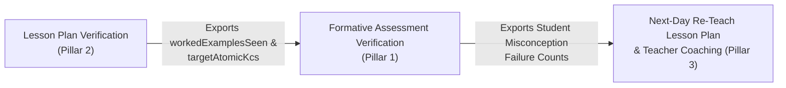

# Pillar 2: Lesson Planning & Instructional Design Formal Verification (Charter)

> **Status:** Architectural Charter — Shares the **Atomic KC DAG** and **Classroom Context Graph** with [Pillar 1 (Formative Assessments)](../01-formative-assessments/README.md).

## 1. How Lesson Planning Connects Directly to Formative Assessment Verification

A formative assessment does not exist in a vacuum—it tests what was taught in a specific **Lesson Plan**. In our neuro-symbolic architecture, the Lesson Plan and the Formative Assessment share the exact same formal state:

---

## 2. Core Provable Invariants for Lesson Plans

When an AI tool generates a 40-minute or 60-minute K–12 Lesson Plan, what can and should Z3 prove?

1. **Prerequisite Topological Ordering (`lesson_kc_topological_order`):**
   - If the lesson introduces Atomic KCs $\{k_1, k_2, k_3\}$ where $k_1 \to k_2$ in the curriculum prerequisite DAG, the instructional activity teaching $k_1$ must occur strictly at an earlier timestamp ($t_{\text{start}}(k_1) < t_{\text{start}}(k_2)$) than $k_2$.
2. **Gradual Release of Responsibility (`I-Do / We-Do / You-Do` Completeness):**
   - For every target Atomic KC $k \in \mathcal{K}_{\text{lesson}}$, the lesson must contain all three instructional phases in strict sequence:
     1. **Direct Modeling (`I-Do`):** Teacher-worked example ($t_{\text{IDo}}(k) > 0$).
     2. **Guided Practice (`We-Do`):** Collaborative practice with Hinge Question check ($t_{\text{WeDo}}(k) > 0$).
     3. **Independent Practice / Formative Check (`You-Do`):** Maps directly to Pillar 1's formative exit ticket ($t_{\text{YouDo}}(k) > 0$).
3. **Instructional Time Partition & Cognitive Attention Span Bounds:**
   - Total duration of all lesson segments must equal the class period ($\sum \Delta t_s = T_{\text{class}}$, e.g. $45\text{ min}$).
   - Uninterrupted teacher lecture (`I-Do`) must not exceed the developmental attention span cap for the stage (e.g., $\le 7\text{ min}$ for `K-2`, $\le 12\text{ min}$ for `G3-5`).
4. **Worked Example Export (`SEEN` Context Registration):**
   - Every example used during `I-Do` and `We-Do` is formally registered in `workedExamplesSeen`, which Pillar 1 uses to guarantee that `You-Do` transfer items ($\text{DoK} \ge 2$) use novel `UNSEEN` contexts.
